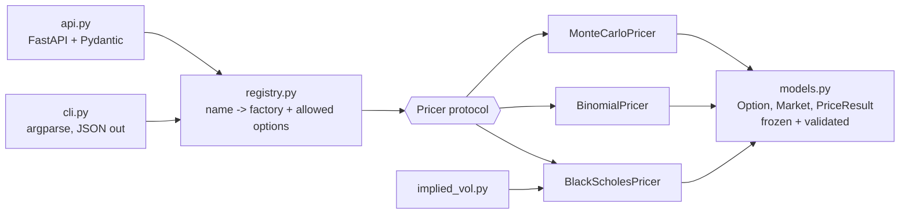

# derivatives-pricing-engine

[](https://github.com/wchetz13/derivatives-pricing-engine/actions/workflows/ci.yml)


A typed, fully tested option pricing library with pluggable models, exposed three ways: a Python API, a JSON-emitting CLI, and a containerized REST service.

The emphasis is on engineering: clean domain modeling, a strategy-pattern pricer interface, strict typing, property-based tests for no-arbitrage invariants, and CI that lints, type-checks, tests across Python versions, and smoke-tests the Docker image.

## Features

| Model | Exercise | Notes |
|---|---|---|
| Black-Scholes-Merton | European | Closed form with continuous dividend yield; analytic Greeks |
| Cox-Ross-Rubinstein binomial tree | European, American | NumPy-vectorized backward induction, O(n) memory |
| Monte Carlo (GBM) | European | Control variate on by default, optional antithetic variates, reproducible seeds, standard errors |

Also included:
- **Implied volatility:** Newton-Raphson with a Brent fallback, and no-arbitrage bound checks.
- **Greeks:** analytic delta, gamma, vega, theta and rho, each verified against finite differences in the tests.
- **Input validation** at the domain boundary. Invalid contracts can't be constructed.

## Architecture



- **`models.py`:** immutable, validated domain objects (`Option`, `Market`, `PriceResult`). Pricers can trust their inputs.
- **`pricers/`:** each model implements the `Pricer` protocol: `price(option, market) -> PriceResult`. Adding a model means writing one class and one `register(...)` call.
- **`registry.py`:** builds pricers by name and rejects options the model doesn't accept (for example, `steps` passed to Black-Scholes). The CLI and API never import concrete pricer classes.
- **Interfaces:** the CLI and API are thin adapters. Domain errors map to exit code `2` in the CLI and HTTP `422` in the API.

## Quickstart

```bash
git clone https://github.com/wchetz13/derivatives-pricing-engine
cd derivatives-pricing-engine
python -m venv .venv && source .venv/bin/activate
make install      # pip install -e ".[dev]"
make check        # ruff + mypy --strict + pytest with coverage
```

### Python

```python
from pricing_engine import Market, Option, OptionType, ExerciseStyle, get_pricer, implied_volatility

market = Market(spot=100, rate=0.05, volatility=0.20)
put = Option(strike=100, maturity=1.0, option_type=OptionType.PUT, style=ExerciseStyle.AMERICAN)

get_pricer("binomial", steps=1000).price(put, market).price   # 6.0896
```

### CLI

```console
$ pricing-engine price --spot 100 --strike 100 --maturity 1 --rate 0.05 --vol 0.2 \
    --model monte_carlo --paths 200000 --seed 42
{
  "price": 10.465133913930169,
  "model": "monte_carlo",
  "std_error": 0.012603938163016817,
  "diagnostics": {"paths": 200000, "antithetic": "false", "control_beta": 0.6751613460731686}
}

$ pricing-engine iv --spot 100 --strike 105 --maturity 0.5 --rate 0.04 --price 4.20
{"implied_volatility": 0.19366611408790738}
```

### REST API

```bash
make serve                     # or: make docker
curl -s -X POST localhost:8000/greeks -H 'Content-Type: application/json' \
  -d '{"spot":100,"strike":100,"maturity":1,"rate":0.05,"volatility":0.2}'
```

```json
{"delta": 0.6368, "gamma": 0.01876, "vega": 37.524, "theta": -6.414, "rho": 53.232}
```

| Method | Path | Purpose |
|---|---|---|
| GET | `/health` | Liveness and version |
| GET | `/models` | Registered models |
| POST | `/price` | Price with any model (`model`, `steps`, `paths`, `seed`, `antithetic`, `control_variate`) |
| POST | `/greeks` | Black-Scholes Greeks |
| POST | `/implied-vol` | Solve for implied volatility from a price |

Interactive docs are served at `/docs`.

## Testing strategy

56 tests, 99% branch coverage, with a 90% minimum enforced in CI.

- **Reference values:** Black-Scholes matches published textbook values (Hull) to 1e-6.
- **Cross-model consistency:**
  - The binomial tree converges to Black-Scholes.
  - Monte Carlo lands within 3 standard errors.
  - The American call with no dividends equals the European call.
  - The American put carries an early-exercise premium.
- **Property-based tests ([Hypothesis](https://hypothesis.readthedocs.io)):** these run on hundreds of random contracts each run:
  - Put-call parity holds.
  - Prices stay within no-arbitrage bounds.
  - Calls increase with spot and volatility.
  - Implied volatility round-trips.
- **Greeks:** each analytic Greek is checked against a central finite difference.
- **Interfaces:** the API is tested through FastAPI's `TestClient`, including the 422 error paths. The CLI is tested through `main(argv)`, checking exit codes and JSON on stderr.

## A design decision backed by measurement

I first combined antithetic variates with the control variate, on the assumption that two variance-reduction methods beat one. Measuring each configuration showed that wasn't true. Standard errors averaged over 5 seeds, with 200,000 paths, S = K = 100, r = 5%, σ = 20%, T = 1:

| Configuration | Std. error |
|---|---|
| Plain | 0.0329 |
| Antithetic only | 0.0232 |
| Control variate only | **0.0125** |
| Both | 0.0175 |

The control variate removes the payoff's linear dependence on the shock. What remains is roughly symmetric in Z, so antithetic pairs become *positively* correlated, and pairing them throws away half the independent samples. So the control variate is on by default and antithetic variates are opt-in. `test_control_variate_beats_antithetic_and_plain` keeps this ordering from regressing.

## Performance

Timings on an Apple-silicon laptop:

| Run | Time |
|---|---|
| American put, binomial, 1,000 steps | 2.5 ms |
| American put, binomial, 2,000 steps | 5.7 ms |
| European call, Monte Carlo, 1,000,000 paths | 17 ms |

The tree uses NumPy slices for each backward-induction step rather than Python loops over nodes.

## Tooling

- **Packaging:** `pyproject.toml` with Hatch, a `py.typed` marker, and a `pricing-engine` console script.
- **Quality:** Ruff for linting and formatting, `mypy --strict`, and pre-commit hooks.
- **CI (GitHub Actions):**
  - Lint and type-check.
  - Run the tests on Python 3.10, 3.11 and 3.12.
  - Build the Docker image and smoke-test it with a live `curl`.
- **Docker:** a multi-stage build that installs a built wheel, runs as a non-root user, and has a healthcheck.

## Project layout

```
src/pricing_engine/
  models.py          domain objects + validation
  registry.py        model lookup
  implied_vol.py     IV solver
  cli.py             command-line interface
  api.py             REST API
  pricers/
    base.py          Pricer protocol
    black_scholes.py
    binomial.py
    monte_carlo.py
tests/               unit, property-based, CLI, and API tests
```

## License

MIT
